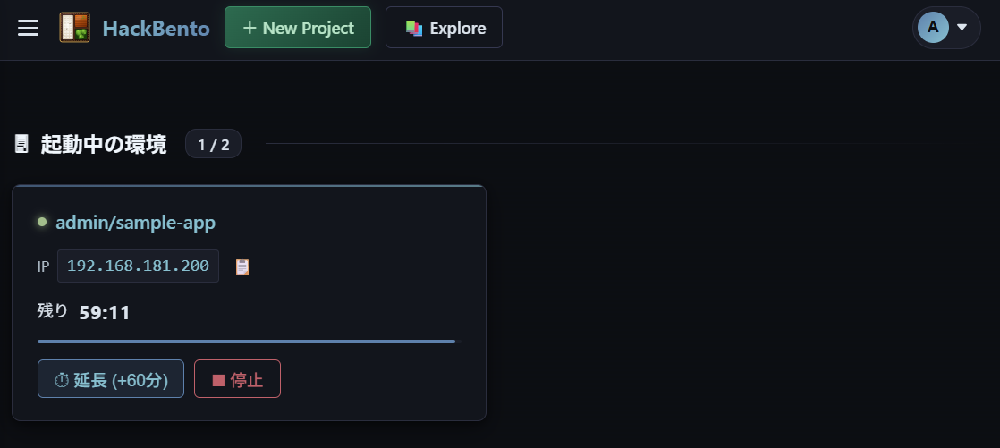

# HackBento

An on-premises environment platform for internal security training and vulnerability reproduction.
Users upload and register guest OS images (kernel + rootfs) or Compose bundles, and other users can select one and launch it as an isolated Firecracker microVM environment — a TryHackMe-like experience that runs entirely on-premises within your internal network.

> **This project is designed to be deployed within a corporate/private network (private IP space).
> It is not intended to be exposed directly to the internet.**

HackBento uses **direct IP assignment to microVMs** (via a Linux bridge), eliminating the need for port mappings or Bastion hosts. Users can SSH directly into the allocated IP address of their environment.



## Features

- **One-click launch** — Select a project and press a button to spin up a Firecracker microVM with an IP address assigned instantly
- **Direct IP access** — Users can SSH, curl, and nmap the allocated IP directly (no Bastion or VPN required)
- **Firecracker microVMs (KVM required)** — Every environment runs as a Firecracker microVM with kernel-level isolation. IP addresses on the physical network are assigned directly via a Linux bridge + TAP interfaces (no port mapping required). Per-VM resource limits (memory, PID count, CPU usage) are enforced host-side via a cgroup v2 delegation tree, and TAP anti-spoof (nftables) prevents a VM from impersonating another IP/MAC even if root is compromised inside the guest
- **Two project formats**:
  - **OS image** (`rootfs_kind=os`) — a guest kernel + rootfs (ext4), for single-VM scenarios that don't run Docker internally (kernel CVE repros, etc.)
  - **Compose bundle** (`rootfs_kind=compose`) — a multi-container `docker compose` project packaged with `tools/hackbento-pack`, baked into a VM image and run inside the guest with its own dockerd. One VM, one IP, with `ports:` served directly on that IP
- **Automatic rootfs tar→ext4 conversion** — Uploading a simple `docker export`-style tar archive as a rootfs is automatically converted to an ext4 image in the background
- **Flexible timeout configuration** — Timeout options (minutes) are configurable via environment variable, including an "unlimited" option (`0`)
- **Attack Machine** — Each user can launch their own personal Kali Linux + XFCE microVM and control it via an embedded GUI (Apache Guacamole / VNC), directly from the home screen
- **3 authentication methods** — Local accounts / LDAP / Google OAuth2
- **Project management** — Manage and share projects via GitHub-style `owner/slug` URLs, with visibility settings and collaborators

## Use Cases

- Internal security training (CTF format)
- Storing and sharing CVE / vulnerability PoC reproduction environments
- Creating and distributing vulnerable machines with embedded flags
- Providing reproducible sandbox environments

## Architecture

```
[Internal Network, e.g. 192.168.181.0/24]

Corporate user terminal
  │
  ├─ Browser → HackBento Web UI (lifecycle management)
  │
  └─ ssh user@192.168.181.200  ← Direct IP access (no Bastion required)
                │
                ▼
         Firecracker microVM (IP assigned directly via bridge network; KVM required)

[Web server role]
  HackBento ──Firecracker REST API──► VM runtime
  (management API only)                 │
                                        ├─ env-001: 192.168.181.200
                                        ├─ env-002: 192.168.181.201
                                        └─ env-003: 192.168.181.202
```

## Tech Stack

| Component | Details |
|---|---|
| Backend | Python 3.12 + FastAPI |
| Frontend | Jinja2 templates + Vanilla JS |
| Database | SQLite (async via aiosqlite) |
| Authentication | JWT (Cookie + Bearer) / LDAP / Google OAuth2 |
| Environment runtime | Firecracker microVM + Linux bridge network (KVM required) |
| GUI access (Attack Machine) | Apache Guacamole, reverse-proxied by HackBento itself |
| Deployment | Docker Compose (`network_mode: host`) |

## Requirements

- Linux host
- Docker Engine / Docker Compose
- KVM (`/dev/kvm`, SVM/VT-x enabled in BIOS) — required for all environments (Firecracker microVMs)
- Ability to create a Linux bridge on the host (`iproute2`, `netplan`, systemd)

## Setup

### 1. Clone the repository

```bash
git clone <repository-url> hack-bento
cd hack-bento
```

### 2. Run the setup script

The interactive `setup.sh` script (requires root) automates everything from network configuration to generation of `.env` / `docker-compose.override.yml`.

```bash
sudo ./setup.sh
```

What the script does:

- Checks for `/dev/kvm` and bridge-creation capability (both required; the script aborts if either is unavailable)
- Detects/asks for the physical NIC, subnet, gateway, and DNS
- Creates a Linux bridge (`vmbr-hackbento`) on the host OS, attaches the physical NIC to it, moves the host IP from the NIC to the bridge, and persists the configuration via `netplan` (survives reboot)
- Sets up a cgroup v2 delegation tree (`/sys/fs/cgroup/hackbento-vms`) used to enforce per-VM resource limits (memory, PID count, CPU usage), plus a systemd service (`hackbento-vm-cgroup.service`) that recreates it on boot
- Generates `.env` (copied from `.env.example`) and sets `BRIDGE_NAME` / `FC_GUEST_GATEWAY` / `IP_POOL_START` / `IP_POOL_END`
- Generates `docker-compose.override.yml` with the devices/cgroup mounts Firecracker needs (`/dev/kvm`, `/dev/net/tun`, `NET_ADMIN`, `cgroup: host`)
- Interactively asks whether to enable **Attack Machine** (Kali Linux + Guacamole GUI); if enabled, generates a `GUACAMOLE_JSON_SECRET_KEY` and appends `guacd`/`guacamole` service definitions to `docker-compose.override.yml`

> To change the network configuration later, run `docker compose -f docker-compose.yml -f docker-compose.override.yml down` and re-run `sudo ./setup.sh` (it regenerates `docker-compose.override.yml`). To only recreate the cgroup delegation tree, use `sudo ./setup.sh --vm-cgroup-only`.

### 3. Review and edit .env

At minimum, check and set the following:

```bash
# Public hostname and port
DOMAIN=your-server.example.com
PORT=8000

# JWT signing key (must be changed)
SECRET_KEY=$(openssl rand -hex 32)
```

The IP pool (`IP_POOL_START`/`IP_POOL_END`) is automatically set to fall within the subnet detected by `setup.sh`, but adjust it if needed. An out-of-range IP will cause the VM to fail to start.

### 4. Start

```bash
docker compose -f docker-compose.yml -f docker-compose.override.yml up -d
```

### 5. Access

```
http://<DOMAIN>:<PORT>/
```

Default admin account: `admin` / `admin` (created automatically on first startup).

**Please change the password immediately after the first login.**
Go to the user icon in the top right → **User Settings** to change it (local users only).

### First login for LDAP / Google OAuth2 users

When logging in via LDAP or Google OAuth2 for the first time, you will be redirected to the username setup screen (`/setup-username`).
Set your desired username to proceed to the home screen. The username cannot be changed once set.

## Authentication Configuration

### LDAP (optional)

```bash
LDAP_ENABLED=true
LDAP_URI=ldap://ldap.example.com:389       # LDAP server URI
LDAP_TOP_DOMAIN=dc=example,dc=com          # BaseDN
LDAP_USER_FILTER=(uid={username})          # User search filter
LDAP_OU_USER=people                        # User OU
LDAP_OU_GROUP=groups                       # Group OU
```

An LDAP connectivity badge (green = reachable, red = unreachable) is displayed on the login screen.

### Google OAuth2 (optional)

1. Create an OAuth 2.0 Client ID in [Google Cloud Console](https://console.cloud.google.com/)
2. Register the following as authorized redirect URIs:
   ```
   http://<DOMAIN>/api/auth/oauth/google/callback        # Port 80
   http://<DOMAIN>:<PORT>/api/auth/oauth/google/callback  # Other ports (http)
   ```
3. Set in `.env`:

```bash
GOOGLE_OAUTH_ENABLED=true
GOOGLE_CLIENT_ID=your-client-id.apps.googleusercontent.com
GOOGLE_CLIENT_SECRET=your-client-secret
OAUTH_ALLOWED_DOMAINS=example.com  # Leave empty to allow all Google accounts
```

## Features

### Project Management

Every project runs as a Firecracker microVM. Projects come in two formats, selected via a toggle on the project creation screen (`Image.rootfs_kind`):

#### OS image (`rootfs_kind=os`)

For a single VM that doesn't run Docker internally (kernel CVE repros, OS-level vulnerable services, etc.).

- Provide a guest kernel and a rootfs (ext4) each via upload, URL link, or by selecting one of the shared default assets registered by an admin (`/admin` → Default VM Assets)
- If a simple `docker export`-style tar is uploaded as the rootfs, it is automatically converted to an ext4 image in the background (a status badge is shown during conversion, and launching is blocked until it completes)
- Extra kernel boot arguments (e.g. `nokaslr`, `nosmep`, `nosmap`, `kpti=0`) can be set per-project for kernel exploit challenges

#### Compose bundle (`rootfs_kind=compose`)

For multiple containers (web + DB + load balancer, etc.) served from a single VM / single IP, with published ports listening directly on that IP.

- Project authors run `tools/hackbento-pack --bundle <dir>` locally (no root required) to package a compose project into a bundle tar
- Upload the bundle on the project creation screen; a background worker validates it, builds it into a VM image inside a network-isolated build VM, and inspects the resulting `docker compose config` for disallowed settings (macvlan/ipvlan networks, external networks, fixed IPs, missing images, etc.)
- At runtime, the guest boots dockerd and runs `docker compose up -d`

Other shared project settings:

- Access projects via `/{owner}/{slug}` URLs
- Visibility settings: `public` (everyone) / `protected` (logged-in users) / `private` (owner, admins, and collaborators only)
- Collaborators: `Read` (view & launch) / `Read-Write` (view, launch & edit)

### Environment Management

- Launch an environment with one click; an IP address is allocated immediately
- Timeout options (minutes) are configurable via `TIMEOUT_MINUTES_OPTIONS` (comma-separated); `0` means unlimited. Invalid values (negative numbers, non-numeric strings) are ignored
- Warning displayed when `TIMEOUT_WARNING_MINUTES` remain (not shown for unlimited environments)
- Maximum `MAX_ENVS_PER_USER` environments per user, `MAX_ENVS_TOTAL` system-wide (admins are exempt from both limits)
- Each environment is subject to CPU/memory/process-count limits enforced host-side via a cgroup v2 delegation tree, reducing host impact from malicious images/VMs
- A background watchdog checks every 30 seconds for expired or crashed environments and cleans them up automatically

### Attack Machine

When `ATTACK_MACHINE_ENABLED=true`, each user can launch their own personal Kali Linux + XFCE microVM (one per user at a time) directly from the home screen, and control it via an embedded GUI powered by Apache Guacamole (reverse-proxied by HackBento itself, so Guacamole's port is never exposed externally).

### Admin Panel (`/admin`)

- **Running environments**: List all active environments across users; force-stop any of them
- **User management**: Add local users, enable/disable, change roles, reset passwords, delete
- **Project management**: List all projects; delete
- **Default VM assets**: Register and manage shared guest kernels/rootfs images that projects can select from when created. Rootfs tar uploads are automatically converted to ext4

## Environment Variables

| Variable | Default | Description |
|---|---|---|
| `APP_TITLE` | `HackBento` | Application name displayed in the Web UI |
| `DOMAIN` | `localhost` | Public hostname |
| `SCHEME` | `http` | `http` or `https` |
| `PORT` | `8000` | Listening port |
| `SECRET_KEY` | (required) | JWT signing key |
| `ACCESS_TOKEN_EXPIRE_MINUTES` | `480` | JWT expiry (minutes) |
| `DATABASE_URL` | SQLite | Database connection URL |
| `DEFAULT_TIMEOUT_MINUTES` | `60` | Default environment timeout (minutes) |
| `TIMEOUT_MINUTES_OPTIONS` | `15,30,45,60,75,90,105,120` | Comma-separated list of selectable timeout options (minutes). `0` means unlimited. Negative/non-numeric values are ignored; falls back to the default list if empty |
| `TIMEOUT_WARNING_MINUTES` | `10` | Minutes remaining before timeout warning |
| `MAX_ENVS_PER_USER` | `2` | Max simultaneous environments per user (admins exempt) |
| `MAX_ENVS_TOTAL` | `20` | Max simultaneous environments system-wide (admins exempt) |
| `VM_CPU_LIMIT` | `1` | CPU limit per environment (cores) |
| `VM_MEMORY_LIMIT_MB` | `1024` | Memory limit per environment (MB) |
| `VM_DISK_LIMIT_GB` | `10` | Disk limit per environment (GB) |
| `VM_PIDS_LIMIT` | `256` | Max process count per environment (fork bomb protection) |
| `UPLOAD_IMAGE_MAX_MB` | `6144` | Max upload size for image/bundle files (MB) |
| `UPLOAD_README_MAX_MB` | `10` | Max upload size for README files (MB) |
| `BRIDGE_NAME` | `vmbr-hackbento` | Name of the host bridge that TAP interfaces attach to (created by `setup.sh`) |
| `FC_GUEST_GATEWAY` | `192.168.180.1` | Gateway routed to the guest (the host's bridge IP) |
| `FC_GUEST_DNS` | `8.8.8.8,8.8.4.4` | Comma-separated DNS servers set on the guest |
| `IP_POOL_START` | `192.168.181.200` | IP pool start address (must be within subnet) |
| `IP_POOL_END` | `192.168.181.230` | IP pool end address (must be within subnet) |
| `ATTACK_MACHINE_ENABLED` | `false` | Enable the Attack Machine feature (Kali Linux + Guacamole GUI) |
| `ATTACK_MACHINE_CPU_LIMIT` | `2` | CPU limit for the Attack Machine (cores) |
| `ATTACK_MACHINE_MEMORY_LIMIT_MB` | `2048` | Memory limit for the Attack Machine (MB) |
| `ATTACK_MACHINE_TIMEOUT_MINUTES` | `60` | Attack Machine timeout (minutes); `0` means unlimited. Read once at first startup and reused thereafter |
| `GUACAMOLE_JSON_SECRET_KEY` | (required if Attack Machine enabled) | AES key used to sign Guacamole auto-login tokens; generated by `setup.sh` |
| `LDAP_ENABLED` | `false` | Enable LDAP authentication |
| `LDAP_URI` | `ldap://...` | LDAP server URI |
| `LDAP_TOP_DOMAIN` | `dc=example,dc=com` | BaseDN |
| `LDAP_USER_FILTER` | `(uid={username})` | User search filter |
| `LDAP_OU_USER` | `people` | User OU |
| `LDAP_OU_GROUP` | `groups` | Group OU |
| `GOOGLE_OAUTH_ENABLED` | `false` | Enable Google OAuth2 |
| `GOOGLE_CLIENT_ID` | (empty) | Google OAuth2 Client ID |
| `GOOGLE_CLIENT_SECRET` | (empty) | Google OAuth2 Client Secret |
| `OAUTH_ALLOWED_DOMAINS` | (empty = all) | Allowed email domains (comma-separated) |

See `.env.example` for full details.

## HTTPS

When `SCHEME=https` is set, uvicorn terminates TLS directly (no reverse proxy such as nginx is required).

```bash
# .env
SCHEME=https
PORT=443
DOMAIN=your-server.example.com
```

If `/data/certs/server.crt` and `/data/certs/server.key` do not exist at startup, a self-signed certificate is generated automatically.
To use a proper certificate, place it at those paths.

If using Google OAuth2, also update the redirect URI in Google Cloud Console to `https://...`.

## Out of Scope (and Why)

- SSH proxying / Web terminal — users SSH directly to the IP
- Public key injection — in CTF scenarios, credentials are part of the challenge
- VPN management — the system is self-contained within the internal network
- Flag submission / scoring — out of scope

## Intended Deployment Environment

This project is designed for deployment in:

- **Corporate networks / private IP space** (RFC 1918: 10.x.x.x / 172.16–31.x.x / 192.168.x.x)
- **Closed networks isolated from the internet**

Because HackBento intentionally handles vulnerable guest images, exposing it to a public network risks unauthorized access by third parties.

## Contributing

If you find a bug or issue, please report it via [Issues](../../issues).

## Disclaimer

The authors and contributors are not liable for any damages arising from the use or inability to use this software, including but not limited to data loss, system failures, or security incidents.

Use this software at your own risk, in an appropriate environment with proper authorization.

## Third-Party Software

HackBento is licensed under the GPL-3.0, but it builds on and runs several third-party open-source components at build time / runtime. These are not redistributed as part of this repository's source, but are downloaded/pulled from their official sources during the Docker build or at container startup. Their own licenses apply to those components:

| Component | License | Notes |
|---|---|---|
| [Firecracker](https://github.com/firecracker-microvm/firecracker) | Apache License 2.0 | microVM runtime; the official release binary is downloaded in `orchestrator/Dockerfile` |
| [Apache Guacamole](https://guacamole.apache.org/) (`guacamole`, `guacd`) | Apache License 2.0 | Used for the Attack Machine's embedded GUI; the official `guacamole/guacamole` and `guacamole/guacd` images are used as a base (see `docker/guacamole/Dockerfile`) |
| [guacamole-auth-json](https://guacamole.apache.org/doc/gug/json-auth.html) | Apache License 2.0 | Guacamole extension bundled into the image above, used for passwordless token-based auto-login |
| Python dependencies (FastAPI, SQLAlchemy, Jinja2, `ldap3`, Authlib, httpx, etc.) | Various (mostly MIT/BSD/Apache-2.0; `ldap3` is LGPL-3.0) | See `orchestrator/requirements.txt` for the full list and pin each package's own license before redistribution |
| Kali Linux / Debian base images (Attack Machine rootfs) | Various (see each distribution's own licensing) | Built automatically on first startup; not bundled in this repository |

Apache License 2.0 is compatible with GPL-3.0 for the purpose of using/aggregating these components alongside HackBento's own GPL-3.0 code; no HackBento source code is derived from or incorporates Firecracker/Guacamole source. If you redistribute a built HackBento image, make sure to retain the license notices required by each bundled component (e.g. any `NOTICE` file shipped with Guacamole/Firecracker).

## License

[GNU General Public License v3.0](LICENSE)

Copyright (C) 2026 ka1222te

This program is free software: you can redistribute it and/or modify it under the terms of the GNU General Public License as published by the Free Software Foundation, either version 3 of the License, or (at your option) any later version.

This program is distributed in the hope that it will be useful, but WITHOUT ANY WARRANTY; without even the implied warranty of MERCHANTABILITY or FITNESS FOR A PARTICULAR PURPOSE. See the GNU General Public License for more details.
